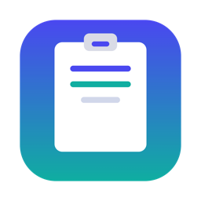
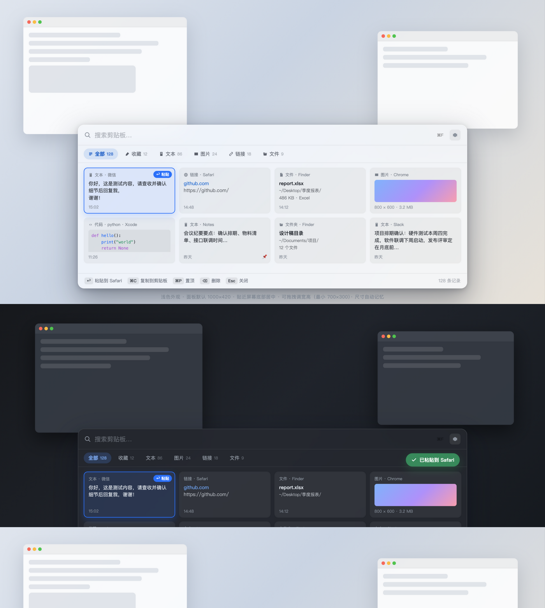

<div align="center">
  

  <h1>ClipPin</h1>

  <p><strong>本地优先的 macOS 原生剪贴板管理器</strong><br/>
  快捷键呼出、全文搜索、图片与文件收藏，数据只留在本机。</p>

  <p>
    
    
    
    
    
  </p>

  <p>
    <a href="#功能">功能</a> •
    <a href="#安装">安装</a> •
    <a href="#快捷键">快捷键</a> •
    <a href="#设置">设置</a> •
    <a href="#构建">构建</a> •
    <a href="#技术架构">技术架构</a> •
    <a href="#隐私">隐私</a> •
    <a href="CHANGELOG.md">更新日志</a>
  </p>
</div>



## 功能

- **快速呼出** — 全局 `⌘⇧V` 在鼠标所在屏幕底部居中呼出面板，可拖拽调整宽高，尺寸跨重启记忆
- **即时搜索** — SQLite FTS5 trigram 全文索引，中英文子串匹配；≥3 字符走 FTS，短词回退 LIKE
- **多类型记录** — 文本 / 链接 / 图片 / 文件 / 文件夹 / 富文本 / 代码（自动识别 JSON、Swift、Python、JS、SQL、Shell 等语言）
- **内容去重** — SHA-256 内容指纹；重复复制只刷新最近使用时间，不会堆出重复行
- **一键粘贴** — `↩` 按「默认操作」执行；`⌘↩` 始终粘贴到当前应用（Quick Paste：写板 → 激活目标 → 合成 `⌘V` → 还原用户原剪贴板）
- **收藏夹** — 新建 Pinboard 文件夹，条目可移入 / 移出；文件夹内条目豁免自动清理与历史上限
- **记录管理** — 置顶（`⌘P`）、命名（`⌘R`）、编辑文本（`⌘E`）、删除可撤销（4 秒滚动窗口）
- **自动清理** — 保留时长 1 / 7 / 30 / 90 天或永不；历史条数上限；孤儿图片清扫；清理频率可自定义
- **图片与文件** — 图片按内容哈希存原图 + 320px 缩略图；文件只存引用与元数据，绝不复制文件本体
- **跨机迁移** — 导出 / 导入单个 `.pasteexport` 文件（图片 base64 内嵌），同名文件夹合并、重复内容自动去重
- **隐私优先** — 暂停记录、排除应用（内置 1Password / 钥匙串 / Bitwarden 等）、`org.nspasteboard` 机密标记一律不入库
- **菜单栏常驻** — 无 Dock 图标、不占 ⌘Tab；登录时启动；浅色 / 深色 / 跟随系统

## 安装

> 需要 **macOS 15.0+** 与 **Apple Silicon（arm64）**。

1. 从 [Releases](https://github.com/zhangyongshuai56-hub/ClipPin/releases) 下载最新的 `ClipPin-<版本>.dmg`
2. 打开 DMG，把 `ClipPin.app` 拖入 `/Applications`
3. 首次启动若被 Gatekeeper 拦截：右键 App → 打开，或到「系统设置 → 隐私与安全性」选择「仍要打开」
4. 需要使用自动粘贴时，按提示在「系统设置 → 隐私与安全性 → 辅助功能」中授权 ClipPin

> 应用使用本地自签名证书构建，未做 Apple 公证；辅助功能授权一次后，重建与升级不会丢失。

## 快捷键

| 操作 | 快捷键 |
| --- | --- |
| 呼出 / 隐藏面板 | `⌘⇧V` |
| 搜索 | `⌘F` |
| 上 / 下 / 左 / 右选择 | `↑` `↓` `←` `→` |
| 执行默认操作（粘贴或复制） | `↩` |
| 粘贴到当前应用 | `⌘↩` |
| 复制到剪贴板 | `⌘C` |
| 置顶 / 取消置顶 | `⌘P` |
| 命名记录 | `⌘R` |
| 编辑文本内容 | `⌘E` |
| 删除（可撤销） | `⌦` |
| 关闭面板 / 退出搜索 | `Esc` |

## 设置

| 页签 | 内容 |
| --- | --- |
| 通用 | 登录时启动、外观（跟随系统 / 浅色 / 深色）、全局快捷键录制 |
| 剪贴板 | 保留时长、历史上限、清理频率与「立即清理」、捕获开关（图片 / 文件 / URL）、单条大小上限 |
| 数据 | 全部文件夹与记录的导出 / 导入 |
| 隐私 | 暂停记录、排除应用（Bundle ID）、辅助功能授权状态 |
| 关于 | 版本信息 |

## 构建

环境：Xcode 16+（macOS 15 SDK）。

```bash
# 构建（Debug）
xcodebuild -scheme ClipPin -configuration Debug -derivedDataPath .build/DerivedData build
# 产物：.build/DerivedData/Build/Products/Debug/ClipPin.app

# 数据层自测（102 项断言，临时库运行后退出）
.build/DerivedData/Build/Products/Debug/ClipPin.app/Contents/MacOS/ClipPin -ClipPinSelfTest

# 打包 DMG（Release + 签名）
Scripts/make-dmg.sh   # 输出 dist/ClipPin-<版本>.dmg
```

签名证书（一次性，幂等）：`Scripts/create-signing-cert.sh`。

## 技术架构

- **界面**：SwiftUI + AppKit（MenuBarExtra + NSPanel），macOS 15.0+，仅 Apple Silicon
- **数据层**：纯 Swift，系统 libsqlite3 直连（WAL / busy_timeout / 事务），schema v5 迁移框架
- **搜索**：FTS5 trigram 外部内容表 + 触发器
- **哈希 / 图片**：CryptoKit SHA-256；ImageIO 下采样生成缩略图
- **存储**：`~/Library/Application Support/Paste/Database/clipboard.db`（历史路径，保持数据兼容）+ `Images/` + `Thumbnails/`
- **依赖**：无第三方依赖，无网络请求

模块划分、调用关系与数据流见 [PROJECT_MAP.md](PROJECT_MAP.md)。

## 隐私

- 所有数据仅保存在本机，应用不发起任何网络请求
- 内置排除密码管理器与钥匙串；`org.nspasteboard` 标记的机密 / 临时内容一律不记录
- 日志只记录 id / 大小 / 耗时，不记录剪贴板内容原文
- 数据库目录权限 0700、库文件 0600（本机其他用户不可读）

## 更新日志

版本历史见 [CHANGELOG.md](CHANGELOG.md)。

## 许可证

[MIT](LICENSE) © 2026 zhangyongshuai56-hub
